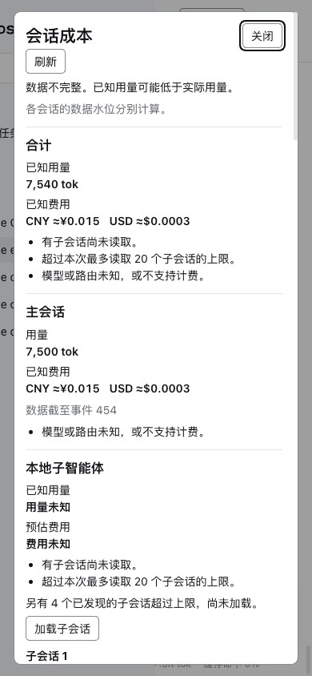
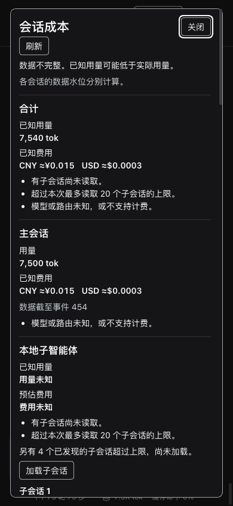

# DSH Costline

[简体中文](README.zh.md)

**One session, 7,540 known tokens. See where they went.** Costline puts exact whole-turn usage and a cost estimate next to the elapsed time in DeepSeek Harness (DSH). Open **Session cost** to see the main conversation, local subagents, and compaction side by side.

| 390 px · light | 390 px · dark |
| --- | --- |
|  |  |

These are captures of the running plugin with an offline test session and example rate overrides. A short demo is planned. [Recording checklist](docs/SCREENSHOTS.md)

## Install in 30 seconds

In **Plugins → Add plugin**, enter `dsh-costline` and confirm the installation. If you already have the DSH CLI, use the profile you actually run:

```sh
dsh plugin --profile web add dsh-costline@0.1.0
```

Use `--profile desktop` for DSH Desktop. Start or reopen the profile, open a chat with recorded usage, and look for the cost beside the completed turn. **Session cost** is in the conversation toolbar.

## What it counts

| Surface | Included |
| --- | --- |
| Turn header or footer | A completed turn's exact recorded model usage across thinking, tool round trips, and retries. Reasoning is included in output once. |
| Session cost | Main-session turns, up to 20 explicitly loaded local child sessions (including nested children), and independently recorded compaction-summary calls. Each session has its own event watermark. |

Turn estimates exclude independent child-session, compaction, and title-generation calls. The session ledger excludes external subagents and inherited fork history. Unread children, missing usage, and unverified summary calls leave visible coverage gaps. A row with known tokens and insufficient pricing detail still contributes its tokens. Known costs are grouped by currency and shown without conversion. These figures estimate model token costs. Separate tool/API charges, credits, and billing adjustments can affect the provider invoice.

## Rates

The built-in table covers recognized official DeepSeek routes. It uses rates from the [DeepSeek CNY price table](https://api-docs.deepseek.com/zh-cn/quick_start/pricing/) and estimates cache writes at the cache-miss rate by default.

| Model | Window | Cache read | Uncached input | Cache write | Output |
| --- | --- | ---: | ---: | ---: | ---: |
| `deepseek-flash` | Peak | ¥0.04 | ¥2 | ¥2 | ¥8 |
| `deepseek-flash` | Off-peak | ¥0.02 | ¥1 | ¥1 | ¥4 |
| `deepseek-v4-pro` | Peak | ¥0.30 | ¥9 | ¥9 | ¥27 |
| `deepseek-v4-pro` | Off-peak | ¥0.15 | ¥4.50 | ¥4.50 | ¥13.50 |

Rates are per million tokens. Costline uses the turn's closing time or the summary's timestamp in Asia/Shanghai. Peak periods run from 09:00–12:00 and 14:00–18:00 on weekdays outside Chinese public holidays. Weekends and holidays are off-peak all day. The bundled calendar covers 2025–2027. Outside those years the weekday schedule applies.

Open **Plugins → Installed → DSH Costline → Configuration** to edit rates and the currency by provider/model. When changing currencies, enter all four prices for both periods. Saving reprices visible usage, including the ledger. **Restore defaults** clears the saved rate overrides. Unsupported routes, mixed routes within a row, and insufficient usage details can leave a row unpriced.

## Compatibility and recovery

The bundle declares DSH `>=0.2.2-rc.3 <0.3.0`. This is the install range. Verified header versions are listed below.

| Runtime | Verification |
| --- | --- |
| DSH Desktop `0.2.2-rc.3` bundled Web Host on macOS arm64 | Header, footer-only, settings, and session ledger checked in a temporary profile. |
| DSH CLI `0.2.2-rc.5` Web Host on macOS arm64 | Header, footer-only, settings, and session ledger checked from the npm tarball. |
| Other admitted versions with a reported version | Auto uses the supported footer slot. |

In **Configuration → Cost placement**, choose **Footer only** to keep DSH's native title and place the estimate below the reply. Auto also falls back when the header structure or render path fails. If DSH does not report a usable version, Auto relies on the header structure check. Disable the bundle from **Plugins → Installed** to remove both the cost line and ledger entry. [DSH rc.5 release](https://github.com/deepseek-ai/deepseek-harness/releases/tag/dsh-v0.2.2-rc.5)

## Privacy

Usage and rate calculations run locally. The plugin makes zero external requests and sends no conversation text or telemetry. DSH supplies local session projections and may cache their accounting metadata in its own projection store. Saving rates or placement writes the plugin's settings through DSH. Opening the ledger is read-only.

## How it differs

Costline focuses on the task in front of you: the same recorded usage DSH exposes for the turn, a rate estimate in the chat header, and an offline ledger you can reconcile against session events. Its bundled rates target official DeepSeek routes. They are editable, with no price feed or exchange-rate service.

## Roadmap

- Retest the header and its fallback with each DSH release.
- Make incomplete historical usage easier to diagnose.
- Record a short demo of a real install and the ledger.

[Source](https://github.com/<github-owner>/dsh-costline) · [Changelog](CHANGELOG.md) · [MIT License](LICENSE)
