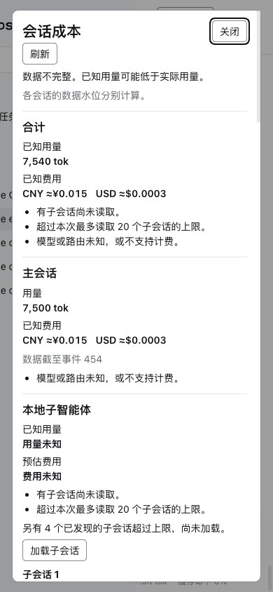
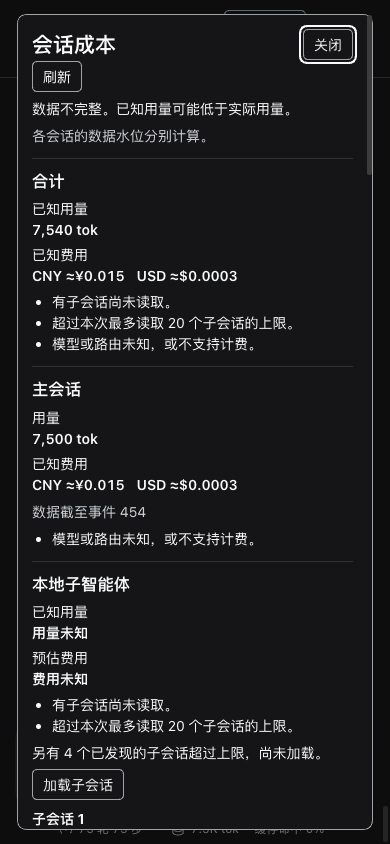

# DSH Costline

[English](README.md)

**一个会话已知 7,540 tok，用量花在哪里？** DSH Costline 在 DeepSeek Harness 的完成用时旁显示整轮精确用量与估算费用。点击「会话成本」，可以拆开看主会话、本地子智能体和压缩摘要。

| 390px 浅色 | 390px 深色 |
| --- | --- |
|  |  |

截图来自运行中的插件，使用离线合成会话与示例费率。短演示待录制。[拍摄清单](docs/SCREENSHOTS.md)

## 30 秒安装

打开 **插件 → 添加插件**，输入 `dsh-costline` 并确认。也可用 CLI 安装到实际使用的 profile：

```sh
dsh plugin --profile web add dsh-costline@0.1.0
```

DSH Desktop 使用 `--profile desktop`。重新打开对应 profile，在有用量记录的会话里查看已完成轮次用时旁的费用。总账入口在会话顶部的工具区。

## 功能与统计口径

| 位置 | 统计范围 |
| --- | --- |
| 轮次标题或页脚 | 主会话整轮的实际模型用量，含思考、工具往返、重试。推理 token 计入输出一次。 |
| 会话总账 | 主会话各轮、手动加载的本地子会话（含递归子会话，上限 20 个）、能确认是独立模型调用的压缩摘要。各会话分别标出数据水位。 |

整轮用量不含独立的子会话、压缩和标题生成调用。会话总账不把外部子智能体和 fork 继承历史计入当前分支。子会话未读取、用量缺失或摘要调用无法确认时会标明覆盖缺项。有精确 token 而缺价格依据的条目仍显示 token，已知费用按币种分别列出。估算只覆盖模型 token，独立工具 API 收费、赠送额度和账单调整可能让实际账单不同。

## 峰谷与价格

内置表覆盖识别出的 DeepSeek 官方路由。数值参照 [DeepSeek 人民币价目表](https://api-docs.deepseek.com/zh-cn/quick_start/pricing/)，插件默认按未命中价估算缓存写入。

| 模型 | 时段 | 缓存读取 | 未缓存输入 | 缓存写入 | 输出 |
| --- | --- | ---: | ---: | ---: | ---: |
| `deepseek-flash` | 高峰 | ¥0.04 | ¥2 | ¥2 | ¥8 |
| `deepseek-flash` | 空闲 | ¥0.02 | ¥1 | ¥1 | ¥4 |
| `deepseek-v4-pro` | 高峰 | ¥0.30 | ¥9 | ¥9 | ¥27 |
| `deepseek-v4-pro` | 空闲 | ¥0.15 | ¥4.50 | ¥4.50 | ¥13.50 |

单位为每百万 token。轮次按结束时间、摘要按摘要事件时间，以北京时间计价。周一至周五 09:00–12:00 与 14:00–18:00 为高峰，周末和中国法定节假日全天空闲。内置节假日表覆盖 2025–2027 年，范围之外按平日时段计算。

在 **插件 → 已安装 → DSH Costline → 配置** 可按提供方和模型改价。换币种需填满两个时段的四项费率。保存后用新价重算，**恢复默认**可清除自定义费率。未知路由、单条用量中混合路由或精确明细不足时，该条可能无法定价。

## 兼容与回退

包声明 DSH `>=0.2.2-rc.3 <0.3.0`。这是安装范围，标题集成的验证范围如下。

| DSH | 已验证行为 |
| --- | --- |
| macOS arm64 上的 DSH Desktop `0.2.2-rc.3` 内置 Web Host | 临时 profile 已检查标题、仅页脚、费率配置和会话总账。 |
| macOS arm64 上的 DSH CLI `0.2.2-rc.5` Web Host | 从 npm tarball 安装，已检查标题、仅页脚、配置和会话总账。 |
| 其他在安装范围内、能报告版本的 DSH | 自动使用受支持的页脚。 |

在配置中的「费用显示位置」选择 **仅页脚**，费用会移到回复下方，系统标题保留。Auto 遇到不兼容结构或渲染错误也会回退。运行时无法报告有效版本时，Auto 通过结构探测决定。要移除费用与总账入口，在 **插件 → 已安装** 停用此 bundle。[DSH rc.5 发布记录](https://github.com/deepseek-ai/deepseek-harness/releases/tag/dsh-v0.2.2-rc.5)

## 隐私

读取用量和计算费用都在本地进行。插件零外部请求，无遥测，不上传会话内容。用量由 DSH 的本地投影提供，DSH 可能把计量元数据保存在自己的投影缓存里。只有保存费率和显示位置时才通过 DSH 写入本插件配置，总账本身只读。

## 与同类插件的区别

Costline 面向当前任务。它用 DSH 已记录的整轮用量，直接集成标题行，按 DeepSeek 官方峰谷口径估算，并提供能和会话事件核对的离线总账。内置费率聚焦 DeepSeek 官方路由，可手动编辑，无外部价格同步和汇率服务。

## 路线图

- 随 DSH 更新复测标题与页脚。
- 让历史会话的用量缺失更容易诊断。
- 补录安装与总账的短演示。

[源码](https://github.com/mimierZBL/dsh-costline) · [变更记录](CHANGELOG.md) · [MIT 许可证](LICENSE)
